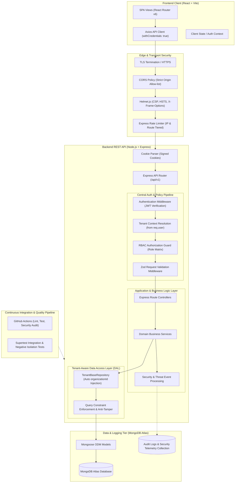
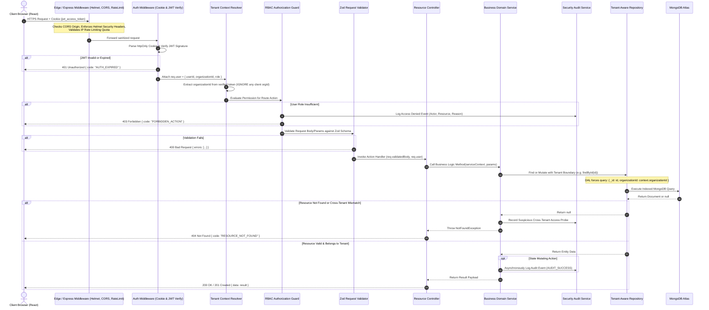

# TenantGuard — System Architecture & Request Lifecycle

## 1. Executive Summary

TenantGuard is a multi-tenant Software-as-a-Service (SaaS) workspace management portal and API. The primary architectural objective is **strict, tamper-proof logical tenant isolation** combined with **verifiable security observability**. While multiple customer organizations share the underlying physical compute and database instances (shared database, shared collection multi-tenancy model), every organization's operational data—users, projects, tasks, invitations, and audit telemetry—remains hermetically segregated.

---

## 2. High-Level Architectural Overview

The platform is designed around a decoupled client-server architecture with defense-in-depth security layers:

---

## 3. Core Architectural Subsystems

### 3.1. Frontend Architecture (React + Vite)
- **Framework & Tooling:** React 18+ bundled with Vite for rapid development and optimized tree-shaken production bundles.
- **Client Routing:** React Router v6 implementing role-aware and authenticated route guards (`<ProtectedRoute>`, `<RoleGuard>`, `<SuperAdminRoute>`).
- **Network Layer:** Axios instance pre-configured with `withCredentials: true` to transparently transmit and receive secure `httpOnly` session cookies. Interceptors handle standard 401/403 responses and trigger session teardown without displaying blank states.
- **Styling Architecture:** Custom Vanilla CSS3 Design System using modern CSS variables, responsive flexbox/grid layouts, glassmorphism cards, and dark-mode accents. No CSS utility bloat or third-party CSS dependencies.
- **Security Posture:** Zero storage of JWT tokens in `localStorage` or `sessionStorage` to mitigate Cross-Site Scripting (XSS) credential theft.

### 3.2. Express REST API Backend
- **Framework:** Node.js runtime with Express.js structured as a layered MVC-Service-Repository architecture.
- **Stateless Application Server:** The API maintains no in-memory session state, enabling horizontal scalability across instances on platforms like Render.
- **Fail-Safe Global Error Handler:** Centralized Express error handler catches unhandled exceptions, logs detailed error traces internally, and delivers sanitized, uniform JSON error messages (`{ status: 'error', code: 'INTERNAL_ERROR', message: '...' }`) to clients, masking database internals and stack traces.

### 3.3. Central Authentication & Authorization Pipeline
- **Authentication:** Short-lived JSON Web Tokens (15-minute expiration) coupled with 7-day refresh tokens delivered exclusively through `httpOnly`, `Secure` (in production), and `SameSite=Strict/Lax` cookies.
- **Password Hashing:** Passwords hashed with `bcryptjs` using 12 salt rounds.
- **Tenant Context Extraction:** The tenant identifier (`organizationId`) is **never** extracted from query parameters, path variables, or request bodies for tenant filtering. It is derived exclusively from the cryptographically verified JWT payload (`req.user.organizationId`).
- **Role-Based Access Control (RBAC):** Middleware checks `req.user.role` against declarative role definitions (`Platform Super Admin`, `Organization Admin`, `Project Manager`, `Member`, `Viewer`).

### 3.4. Tenant-Aware Data Access Layer (DAL)
- Instead of raw Mongoose model invocations scattered across controllers, all data mutations and queries route through a specialized `TenantRepository` base pattern.
- The `TenantRepository` automatically binds `{ organizationId: context.organizationId }` to every `find`, `findOne`, `findById`, `countDocuments`, `updateOne`, and `deleteMany` call.
- Any attempt to query a resource by `id` without matching `organizationId` returns a `null` / `RESOURCE_NOT_FOUND` (HTTP 404) rather than HTTP 403, preventing attackers from confirming the existence of resources belonging to competing organizations (enumeration defense).

### 3.5. MongoDB Atlas Database & Indexing Strategy
- **Logical Multi-Tenancy:** A shared database and shared collection architecture with strict discriminant property (`organizationId`).
- **Compound Indexing:** All organization-bound collections employ compound indexes where `organizationId` is the leading prefix (e.g., `{ organizationId: 1, _id: 1 }`, `{ organizationId: 1, status: 1 }`). This guarantees index-level partition selectivity, preventing cross-tenant index scans and maximizing query performance.
- **Separate SuperAdmin Collection:** Platform Super Admins are stored in an independent collection (`platform_admins`) completely separated from organization `users`. This eliminates privilege-escalation vectors through accidental role assignment within tenant user records.

### 3.6. Audit Logging & Security Event Processing
- **Event-Driven Telemetry:** Centralized `SecurityEventService` records both successful high-impact operations (e.g., member invitations, role modifications, MFA toggles) and security-critical anomalies (e.g., failed login sprees, unauthorized resource access attempts, tenant ID spoofing attempts).
- **Immutable Log Store:** Audit logs include timestamp, actor ID, actor email, client IP, user agent, target entity type, action verb, and outcome.
- **Isolation Threat Alarms:** Cross-tenant access attempts immediately increment risk counters and trigger high-severity alerts in the Security Center.

### 3.7. Automated Testing & Continuous Integration (CI)
- **Test Matrix:** Jest and Supertest for unit, integration, and security regression testing.
- **Negative Cross-Tenant Test Suite:** Dedicated test suite creates two distinct organizations (Tenant A and Tenant B) and systematically verifies that Tenant A's token cannot read, update, or delete any resource of Tenant B.
- **GitHub Actions Workflow:** Automatically runs linting, unit tests, and Supertest cross-tenant isolation suites on every pull request and push to `main`.

---

## 4. End-to-End Request Lifecycle & Data Flow

The following sequence diagram traces an HTTP request (e.g., `GET /api/v1/projects/:id` or `POST /api/v1/tasks`) from the browser to the database and back:

---

## 5. Architectural Invariants

Every component in TenantGuard must strictly adhere to the following non-negotiable architectural invariants:

1. **Infallible Tenant Identity:** The active tenant identifier is derived strictly from the cryptographically verified JWT inside the `httpOnly` cookie. No HTTP header (e.g., `X-Tenant-ID`), query string parameter, or body attribute can override or declare the tenant context for an operational user.
2. **Implicit Query Scoping:** Developers writing application services must never write manual `{ organizationId: req.user.organizationId }` clauses on raw queries. All queries must flow through the Tenant-Aware Repository layer where scoping is applied deterministically.
3. **Anti-Enumeration Responses:** If User of Tenant A requests `/api/v1/projects/TENANT_B_PROJECT_ID`, the server returns `404 Not Found`. It must **never** return `403 Forbidden` for existing foreign entities, as doing so confirms that the ID exists in the database.
4. **Privilege Segregation:** Platform Super Admins possess access only to platform metrics, organization provisioning, and subscription/status controls. Super Admins possess **zero** database access pathways to read or modify tenant-private project or task content.
5. **No Blind Trust in Client:** All data mutations (create, update, delete) are strictly validated by Zod schemas prior to reaching any controller or service logic.
