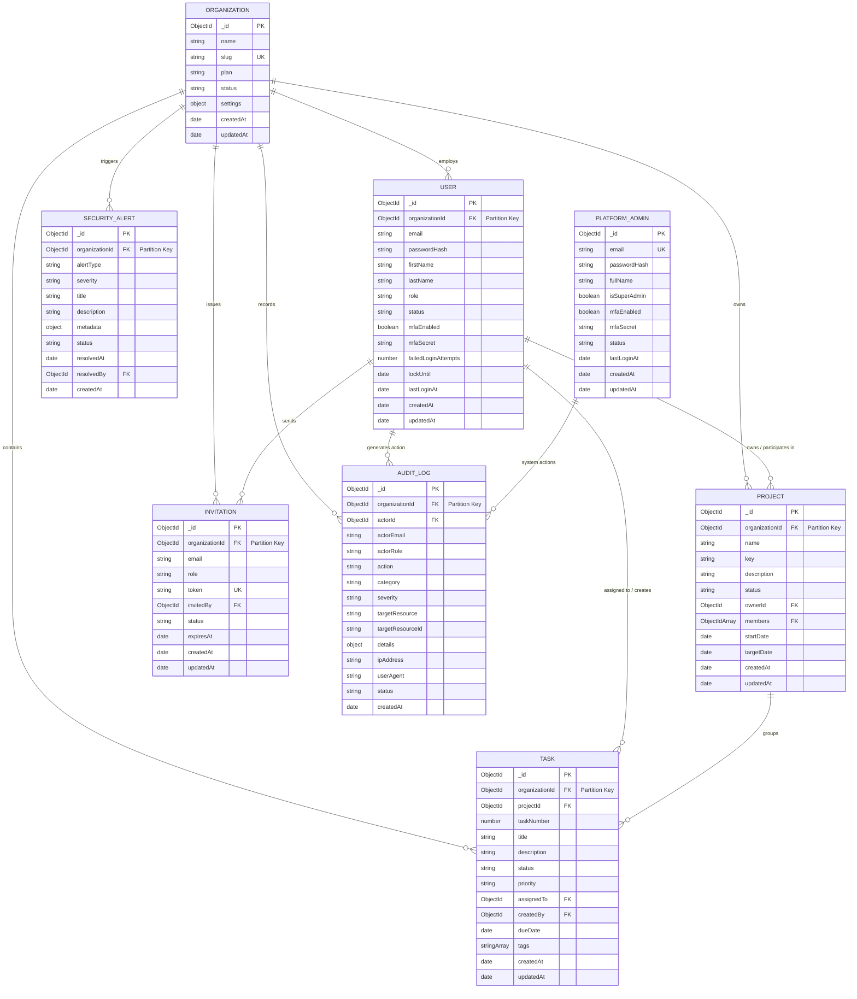

# TenantGuard — Database Design & Data Models

## 1. Multi-Tenancy Data Architecture

TenantGuard implements a **Shared Database, Shared Collections** multi-tenancy model governed by **logical discriminator partition keys**.

Every record owned by an organization contains an immutable `organizationId` field. To ensure that MongoDB physically and logically optimizes query execution across isolated partitions, every query in the application uses compound indexes prefixed by `organizationId`.

### Architectural Rule: Model Segregation
To prevent any possibility of privilege confusion or accidental authorization elevation, **Platform Administrators** are stored in a dedicated, isolated collection (`platform_admins`) completely separated from tenant `users`. A tenant user record cannot become a platform super admin, and platform admins cannot be retrieved or mutated through tenant API routes.

---

## 2. Entity Relationship Diagram (ERD)

---

## 3. Data Model Specifications

### 3.1. Organization (`organizations`)
The top-level tenant entity representing an enterprise or company workspace.

- **Fields:**
  - `_id`: `ObjectId` — Primary Key.
  - `name`: `String` (Required, Trim, 2-100 characters) — Organization business name.
  - `slug`: `String` (Required, Unique, Lowercase, Trim, Regex `^[a-z0-9-]+$`) — URL-friendly unique identifier for the workspace.
  - `plan`: `String` (Enum: `['free', 'pro', 'enterprise']`, Default: `'free'`) — Subscription tier.
  - `status`: `String` (Enum: `['active', 'suspended', 'deactivated']`, Default: `'active'`) — Operational status.
  - `settings`: `Object`:
    - `enforceMfa`: `Boolean` (Default: `false`) — Whether all organization users must configure TOTP.
    - `allowedEmailDomains`: `[String]` (Default: `[]`) — Optional domain restriction for member invitations.
    - `sessionTimeoutMinutes`: `Number` (Default: `60`) — Idle session timeout limit.
  - `createdAt`: `Date` — Auto-generated timestamp.
  - `updatedAt`: `Date` — Auto-generated timestamp.

- **Indexes:**
  - `{ slug: 1 }` (Unique) — Fast slug lookup during tenant routing.
  - `{ status: 1 }` — Filtering active vs suspended tenants during platform billing audits.

---

### 3.2. User (`users`)
An authenticated identity affiliated with a specific organization tenant.

- **Fields:**
  - `_id`: `ObjectId` — Primary Key.
  - `organizationId`: `ObjectId` (Required, Ref: `Organization`) — Immutable tenant boundary key.
  - `email`: `String` (Required, Lowercase, Trim, Valid Email) — User contact and login identifier.
  - `passwordHash`: `String` (Required, Select: `false`) — bcrypt-hashed password (cost factor 12).
  - `firstName`: `String` (Required, Trim, 1-50 characters).
  - `lastName`: `String` (Required, Trim, 1-50 characters).
  - `role`: `String` (Enum: `['org_admin', 'project_manager', 'member', 'viewer']`, Default: `'member'`) — Tenant RBAC role.
  - `status`: `String` (Enum: `['active', 'invited', 'suspended']`, Default: `'active'`).
  - `mfaEnabled`: `Boolean` (Default: `false`) — Whether TOTP 2FA is active.
  - `mfaSecret`: `String` (Select: `false`, Encrypted/Hashed) — Base32 TOTP secret string.
  - `failedLoginAttempts`: `Number` (Default: `0`) — Counter for account lockout logic.
  - `lockUntil`: `Date` (Nullable, Default: `null`) — Timestamp until which login attempts are rejected.
  - `lastLoginAt`: `Date` (Nullable) — Audit timestamp of last successful session creation.
  - `createdAt`: `Date`.
  - `updatedAt`: `Date`.

- **Indexes:**
  - `{ organizationId: 1, email: 1 }` (Unique) — Prevents duplicate emails inside the same organization while allowing an individual to participate in multiple organizations with distinct profiles.
  - `{ email: 1 }` — Enables fast credential lookup during global authentication.
  - `{ organizationId: 1, role: 1 }` — Speeds up member filtering and permission checks.
  - `{ organizationId: 1, status: 1 }` — Filter active workspace members.

---

### 3.3. Project (`projects`)
A collaborative project workspace contained within an organization.

- **Fields:**
  - `_id`: `ObjectId` — Primary Key.
  - `organizationId`: `ObjectId` (Required, Ref: `Organization`) — Tenant boundary key.
  - `name`: `String` (Required, Trim, 2-100 characters).
  - `key`: `String` (Required, Uppercase, Trim, 2-10 characters, Regex `^[A-Z0-9]+$`) — Short identifier prefix for tasks (e.g. `PROJ`).
  - `description`: `String` (Optional, Trim, max 2000 characters).
  - `status`: `String` (Enum: `['planning', 'active', 'on_hold', 'completed', 'archived']`, Default: `'planning'`).
  - `ownerId`: `ObjectId` (Required, Ref: `User`) — Creator or designated project manager.
  - `members`: `[ObjectId]` (Array of Refs: `User`, Default: `[]`) — Explicitly assigned project collaborators.
  - `startDate`: `Date` (Nullable).
  - `targetDate`: `Date` (Nullable).
  - `createdAt`: `Date`.
  - `updatedAt`: `Date`.

- **Indexes:**
  - `{ organizationId: 1, key: 1 }` (Unique) — Guarantees project key uniqueness inside each organization.
  - `{ organizationId: 1, status: 1, createdAt: -1 }` — Optimizes project dashboard and listing queries.
  - `{ organizationId: 1, ownerId: 1 }` — Enables quick lookup of projects managed by a user.
  - `{ organizationId: 1, members: 1 }` — Enables quick lookup of projects a member participates in.

---

### 3.4. Task (`tasks`)
An actionable work item associated with a project and partitioned by organization.

- **Fields:**
  - `_id`: `ObjectId` — Primary Key.
  - `organizationId`: `ObjectId` (Required, Ref: `Organization`) — Tenant boundary key.
  - `projectId`: `ObjectId` (Required, Ref: `Project`) — Parent project reference.
  - `taskNumber`: `Number` (Required) — Sequential task integer within the project (e.g., 1 -> `PROJ-1`).
  - `title`: `String` (Required, Trim, 2-200 characters).
  - `description`: `String` (Optional, Trim, max 10000 characters).
  - `status`: `String` (Enum: `['todo', 'in_progress', 'in_review', 'done']`, Default: `'todo'`).
  - `priority`: `String` (Enum: `['low', 'medium', 'high', 'urgent']`, Default: `'medium'`).
  - `assignedTo`: `ObjectId` (Nullable, Ref: `User`) — Assignee.
  - `createdBy`: `ObjectId` (Required, Ref: `User`) — Task creator.
  - `dueDate`: `Date` (Nullable).
  - `tags`: `[String]` (Default: `[]`, max 10 items, 30 chars each).
  - `createdAt`: `Date`.
  - `updatedAt`: `Date`.

- **Indexes:**
  - `{ organizationId: 1, projectId: 1, taskNumber: 1 }` (Unique) — Guarantees task numbering integrity within a project.
  - `{ organizationId: 1, projectId: 1, status: 1 }` — Powers Kanban board column filtering.
  - `{ organizationId: 1, assignedTo: 1, status: 1 }` — Powers personal "My Tasks" dashboards.
  - `{ organizationId: 1, priority: 1 }` — Speeds up priority task sorting.
  - `{ organizationId: 1, createdAt: -1 }` — General recency ordering.

---

### 3.5. Invitation (`invitations`)
A secure time-limited invitation token allowing a new user to join a specific tenant organization with a designated role.

- **Fields:**
  - `_id`: `ObjectId` — Primary Key.
  - `organizationId`: `ObjectId` (Required, Ref: `Organization`) — Tenant boundary key.
  - `email`: `String` (Required, Lowercase, Trim, Valid Email) — Invitee destination address.
  - `role`: `String` (Enum: `['org_admin', 'project_manager', 'member', 'viewer']`, Default: `'member'`).
  - `token`: `String` (Required, Unique) — Cryptographic random SHA-256 token hash.
  - `invitedBy`: `ObjectId` (Required, Ref: `User`) — Admin who dispatched invitation.
  - `status`: `String` (Enum: `['pending', 'accepted', 'expired', 'revoked']`, Default: `'pending'`).
  - `expiresAt`: `Date` (Required) — Invitation expiration cutoff (default 7 days from creation).
  - `createdAt`: `Date`.
  - `updatedAt`: `Date`.

- **Indexes:**
  - `{ token: 1 }` (Unique) — Instant token validation lookup.
  - `{ organizationId: 1, email: 1, status: 1 }` — Prevents duplicate active invitations to the same email within an org.
  - `{ expiresAt: 1 }` (TTL Index: `expireAfterSeconds: 0`) — Automatic document cleanup of stale invitation records.

---

### 3.6. AuditLog (`audit_logs`)
Tamper-resistant operational telemetry capturing user actions and security events.

- **Fields:**
  - `_id`: `ObjectId` — Primary Key.
  - `organizationId`: `ObjectId` (Nullable for system events, Ref: `Organization`) — Tenant partition key.
  - `actorId`: `ObjectId` (Nullable for anonymous/failed auth, Ref: `User` or `PlatformAdmin`).
  - `actorEmail`: `String` (Required, Trim).
  - `actorRole`: `String` (Required, e.g. `'org_admin'`, `'anonymous'`, `'platform_super_admin'`).
  - `action`: `String` (Required, Trim, e.g., `'USER_LOGIN_SUCCESS'`, `'USER_LOGIN_FAILED'`, `'PROJECT_CREATED'`, `'ROLE_UPDATED'`, `'ISOLATION_VIOLATION_ATTEMPT'`).
  - `category`: `String` (Enum: `['auth', 'access_control', 'data_mutation', 'security_violation', 'system']`).
  - `severity`: `String` (Enum: `['info', 'warning', 'high', 'critical']`, Default: `'info'`).
  - `targetResource`: `String` (e.g., `'Project'`, `'Task'`, `'User'`, `'Organization'`).
  - `targetResourceId`: `String` (Identifier of target entity).
  - `details`: `Object` — Sanitized metadata (does not contain passwords, raw tokens, or PII).
  - `ipAddress`: `String` (Client IPv4 / IPv6).
  - `userAgent`: `String` (Browser/Client header).
  - `status`: `String` (Enum: `['success', 'denied', 'failed']`).
  - `createdAt`: `Date` (Immutable).

- **Indexes:**
  - `{ organizationId: 1, createdAt: -1 }` — Powers chronological audit log explorer in Security Center.
  - `{ organizationId: 1, severity: 1, createdAt: -1 }` — Filter by security threat severity.
  - `{ organizationId: 1, category: 1 }` — Category faceted search.
  - `{ actorId: 1, createdAt: -1 }` — User activity history audit.

---

### 3.7. SecurityAlert (`security_alerts`)
Aggregated security incident notifications surfaced directly in the tenant Security Center.

- **Fields:**
  - `_id`: `ObjectId` — Primary Key.
  - `organizationId`: `ObjectId` (Required, Ref: `Organization`) — Tenant partition key.
  - `alertType`: `String` (Enum: `['ISOLATION_BREACH_ATTEMPT', 'BRUTE_FORCE_LOCKOUT', 'MFA_DISABLED', 'SUSPICIOUS_TOKEN_REUSE']`).
  - `severity`: `String` (Enum: `['warning', 'high', 'critical']`).
  - `title`: `String` (Required).
  - `description`: `String` (Required).
  - `metadata`: `Object` (Payload context).
  - `status`: `String` (Enum: `['open', 'acknowledged', 'resolved']`, Default: `'open'`).
  - `resolvedAt`: `Date` (Nullable).
  - `resolvedBy`: `ObjectId` (Nullable, Ref: `User`).
  - `createdAt`: `Date`.

- **Indexes:**
  - `{ organizationId: 1, status: 1, createdAt: -1 }` — Unresolved security alert stream.
  - `{ organizationId: 1, severity: 1 }` — Severity-sorted alerts.

---

### 3.8. PlatformAdmin (`platform_admins`)
Physically and logically separated collection for platform-wide infrastructure administrators.

- **Fields:**
  - `_id`: `ObjectId` — Primary Key.
  - `email`: `String` (Required, Unique, Lowercase, Trim).
  - `passwordHash`: `String` (Required, Select: `false`).
  - `fullName`: `String` (Required, Trim).
  - `isSuperAdmin`: `Boolean` (Immutable, Default: `true`).
  - `mfaEnabled`: `Boolean` (Default: `false`).
  - `mfaSecret`: `String` (Select: `false`).
  - `status`: `String` (Enum: `['active', 'suspended']`, Default: `'active'`).
  - `lastLoginAt`: `Date` (Nullable).
  - `createdAt`: `Date`.
  - `updatedAt`: `Date`.

- **Indexes:**
  - `{ email: 1 }` (Unique) — Global lookup for Platform Super Admin credentials.

---

## 4. Compound Index Optimization Strategy

In multi-tenant databases with shared collections, standard non-compound indexes (such as indexing just `status` or `name`) can lead to costly full collection scans or massive cross-tenant index traversals.

TenantGuard enforces a strict indexing convention:
1. **The Equality, Sort, Range (ESR) Rule:** Compound indexes start with the exact equality filter (`organizationId`), followed by the sort attribute (`createdAt: -1`), followed by range or category filters.
2. **Strict Compound Prefixes:**
   - Tasks: `{ organizationId: 1, projectId: 1, status: 1 }`
   - Projects: `{ organizationId: 1, status: 1, createdAt: -1 }`
   - Audit Logs: `{ organizationId: 1, createdAt: -1 }`
   - Users: `{ organizationId: 1, email: 1 }`
3. **Guaranteed Tenant Sharding Preparedness:** Should the database scale beyond a single replica set to a sharded cluster, the compound prefix `{ organizationId: 1, ... }` aligns directly with the optimal shard key strategy.
