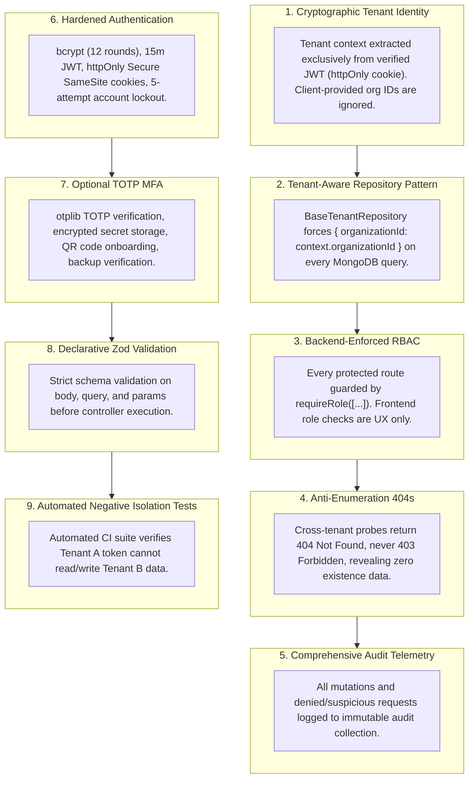

# TenantGuard — Security Architecture & Threat Model

## 1. Security Philosophy & Principles

TenantGuard is built around the premise that **multi-tenant isolation is the primary security boundary**. A flaw in tenant segregation can lead to catastrophic data spillage between competing enterprises.

### Core Security Principles:
1. **Zero Implicit Trust:** No request is trusted based on network origin, client-side claims, or previous session state.
2. **Fail-Closed by Default:** Any parsing failure, missing claim, expired token, or unverified permission results in immediate request termination.
3. **Verified Context Over User Input:** The active tenant boundary (`organizationId`) is determined exclusively by the cryptographically verified JWT payload, **never** by request headers (such as `X-Tenant-ID`), query parameters, or request body payloads.
4. **Anti-Enumeration Responses:** Requests probing cross-tenant resources return `404 Not Found` (identical to non-existent resources) rather than `403 Forbidden`, preventing attackers from mapping out IDs belonging to foreign organizations.
5. **Defense-in-Depth:** Multiple redundant controls (HTTP security headers, rate limiting, schema validation, RBAC middleware, tenant-aware repositories, and database indexing constraints) protect data at every tier.

---

## 2. Threat Modeling (STRIDE Analysis)

| Threat Category | Potential Attack Vector | TenantGuard Mitigation Control |
| :--- | :--- | :--- |
| **Spoofing** | Attacker crafts a fake JWT or tampers with tenant identifier in headers or body. | Signed JWT with HS256/RS256 secret. `organizationId` is extracted strictly from verified token claims. Input parameters named `organizationId` are stripped/ignored. |
| **Tampering** | Malicious user intercepts and alters another organization's task or project ID in URL. | Tenant-aware repository automatically appends `{ organizationId: req.user.organizationId }` to every DB operation. Even if the ID exists in MongoDB, the query returns `null`. |
| **Repudiation** | User denies performing a destructive action (e.g. deleting a project or changing user roles). | Immutable `audit_logs` record every mutating action with actor ID, email, role, IP address, user agent, timestamp, and detailed diffs. |
| **Information Disclosure** | Cross-tenant probing reveals resource existence via status code differentials or stack traces. | 1. Uniform `404 Not Found` on cross-tenant attempts.<br/>2. Global error handler strips stack traces in production.<br/>3. Password hashes and MFA secrets have `{ select: false }`. |
| **Denial of Service** | Brute force login attempts or API query flooding exhaust compute and database resources. | 1. Tiered IP rate limiting (`express-rate-limit`).<br/>2. Account lockout after 5 consecutive failed login attempts (15-minute freeze).<br/>3. Request body size caps (100kb). |
| **Elevation of Privilege** | Tenant user attempts to access Platform Admin endpoints or promote themselves to Admin. | 1. Separate `platform_admins` collection with separate auth guard.<br/>2. Backend RBAC middleware checks route permission against verified token role.<br/>3. Role update endpoints require `org_admin` role. |

---

## 3. The 9 Core Security Controls



### Detailed Breakdown of Controls:

### Control 1: Verified Tenant Identity Context
- When a user logs in, the server generates a signed JWT containing `{ userId, organizationId, role }`.
- In all downstream middleware and services, `req.organizationId = req.user.organizationId`.
- **Zero-Trust Input Policy:** If a client submits `{ organizationId: "evil_id" }` in the POST body or `?organizationId=evil_id` in the query, the Zod validator strips it or rejects the request. The application never uses client-supplied organization IDs for tenant routing.

### Control 2: Tenant-Aware Repository Pattern (DAL)
To prevent accidental omissions of `{ organizationId }` by developers, the data access layer uses a `BaseTenantRepository`:
```javascript
class BaseTenantRepository {
  constructor(model, organizationId) {
    this.model = model;
    this.organizationId = organizationId;
  }

  async findById(id) {
    return this.model.findOne({ _id: id, organizationId: this.organizationId });
  }

  async find(filter = {}, options = {}) {
    const tenantFilter = { ...filter, organizationId: this.organizationId };
    return this.model.find(tenantFilter, null, options);
  }

  async updateById(id, updateData) {
    return this.model.findOneAndUpdate(
      { _id: id, organizationId: this.organizationId },
      { $set: updateData },
      { new: true, runValidators: true }
    );
  }

  async deleteById(id) {
    return this.model.findOneAndDelete({ _id: id, organizationId: this.organizationId });
  }
}
```

### Control 3: Backend RBAC Enforcement
- Role checks are performed by Express middleware before the controller runs.
- Frontend conditional rendering (`user.role === 'org_admin' ? <DeleteBtn/> : null`) is treated strictly as a visual convenience, never as a security control.

### Control 4: Anti-Enumeration Response Uniformity
- When a user from Tenant A requests `GET /api/v1/projects/65b38...` (which belongs to Tenant B):
  - The repository executes `Project.findOne({ _id: '65b38...', organizationId: 'tenant_a_id' })`.
  - MongoDB returns `null`.
  - The service throws `NotFoundError("Project not found")`.
  - The API responds with `HTTP 404 Not Found`.
- An attacker testing random or sequential IDs receives `HTTP 404` regardless of whether the ID belongs to another tenant or does not exist at all.

### Control 5: Audit Logging and Security Incident Alerts
- Mutating actions (`PROJECT_CREATE`, `USER_INVITE`, `ROLE_CHANGE`) create an `AuditLog` record.
- Any attempt to access a resource that triggers a tenant mismatch increments the security risk counter for that session and records a `ISOLATION_VIOLATION_ATTEMPT` audit entry.
- When cross-tenant attempts exceed 3 within 10 minutes, an automated `SECURITY_ALERT` is triggered for the organization administrators.

### Control 6: Token Lifecycle, Storage & Account Lockout
- **JWT Storage:** JWTs are stored exclusively in `httpOnly`, `SameSite=Strict/Lax`, `Secure` (in production) cookies. JavaScript cannot access the token via `document.cookie`, neutralizing XSS token theft.
- **Token Expiry:** Access tokens expire in 15 minutes. Refresh tokens expire in 7 days and support token rotation and invalidation.
- **Brute Force Lockout:** After 5 failed password attempts, the user record is locked for 15 minutes (`lockUntil = Date.now() + 15 * 60 * 1000`).

### Control 7: Multi-Factor Authentication (TOTP)
- Built with `otplib` using standard HMAC-SHA1 RFC 6238 time-based tokens.
- Secret is generated on server, returned as a data URI QR code, and saved to the database only after the user proves successful token generation by submitting a valid 6-digit code.
- Users with MFA enabled must complete step 1 (password) followed by step 2 (TOTP verification) before receiving their active session token.

### Control 8: Strict Zod Request Validation
- All routes validate headers, URL parameters, and request bodies against strict Zod schemas with `.strict()`, rejecting unrecognised or malicious properties.
- Input fields are trimmed and sanitized against SQL/NoSQL injection operators (e.g. `$ne`, `$gt`, `$where`).

### Control 9: Automated Negative Isolation Testing
- The continuous integration pipeline runs a dedicated suite of integration tests specifically designed to fail if isolation breaks:
  - Tenant A reads Tenant B's project -> Asserts `404 Not Found`.
  - Tenant A updates Tenant B's task status -> Asserts `404 Not Found`.
  - Tenant A deletes Tenant B's user -> Asserts `404 Not Found`.
  - Tenant A injects foreign `organizationId` in payload -> Asserts `organizationId` is disregarded.

---

## 4. Role-Based Access Control (RBAC) Matrix

TenantGuard defines five distinct roles:
1. **Platform Super Admin (`platform_super_admin`):** Platform-level manager. Manages tenant accounts, billing status, and platform health. **Strictly prohibited from reading tenant workspace content (projects, tasks).**
2. **Organization Admin (`org_admin`):** Full administrative authority within their own organization.
3. **Project Manager (`project_manager`):** Creates and manages projects, assigns tasks, and oversees project members.
4. **Member (`member`):** Creates tasks, updates task progress, and collaborates on assigned projects.
5. **Viewer (`viewer`):** Read-only visibility into projects and tasks within the organization.

### Comprehensive Permission Matrix:

| Action / Capability | Platform Super Admin | Org Admin | Project Manager | Member | Viewer |
| :--- | :---: | :---: | :---: | :---: | :---: |
| **Manage Organizations (Suspend/Activate)** | Yes | No | No | No | No |
| **View Platform Global Metrics** | Yes | No | No | No | No |
| **Read Organization Projects/Tasks Content** | **NO** | Yes | Yes | Yes | Yes |
| **Manage Organization Settings & Billing** | No | Yes | No | No | No |
| **Invite & Manage Organization Users** | No | Yes | No | No | No |
| **Assign / Change User Roles** | No | Yes | No | No | No |
| **View Organization Audit Logs & Security Center**| No | Yes | No | No | No |
| **Create Projects** | No | Yes | Yes | No | No |
| **Edit / Archive Projects** | No | Yes | Yes (Owner) | No | No |
| **Delete Projects** | No | Yes | No | No | No |
| **Create Tasks** | No | Yes | Yes | Yes | No |
| **Update / Reassign Tasks** | No | Yes | Yes | Yes | No |
| **Delete Tasks** | No | Yes | Yes | No | No |
| **View Projects & Tasks** | No | Yes | Yes | Yes | Yes |
| **Manage Own Profile & Enable MFA** | Yes | Yes | Yes | Yes | Yes |

---

## 5. Security Trade-Offs & Explicit Assumptions

A rigorous security engineering approach acknowledges real-world trade-offs and operational assumptions:

1. **Shared Database vs. Separate Database per Tenant:**
   - *Trade-off:* We employ a shared database with shared collections for operational cost efficiency, fast tenant onboarding, and simplified connection pool management.
   - *Risk:* A developer bypass of the `TenantRepository` could theoretically allow cross-tenant data exposure.
   - *Mitigation:* Layered defenses (middleware + repository + compound indexes + automated negative CI tests).
2. **Symmetric JWT Secret vs. Asymmetric Keys:**
   - *Trade-off:* HMAC SHA-256 (`HS256`) is chosen for Stage 1-3 simplicity rather than RSA/ECDSA public-private key pairs (`RS256`).
   - *Assumption:* The secret key is managed securely via environment variables and never shared across external microservices.
3. **NoSQL Injection Vulnerabilities:**
   - *Assumption:* Express JSON body parser receives standard JSON. Attackers could attempt object injection (e.g. `{ "email": { "$ne": null } }`).
   - *Mitigation:* Zod schema validation enforces strict string types (`z.string().email()`), stripping nested MongoDB query operators before queries execute.
4. **Denial of Service (DDoS):**
   - *Trade-off:* Application-level rate limiting (`express-rate-limit`) protects API endpoints from basic script floods but cannot withstand high-volume distributed DDoS attacks.
   - *Assumption:* Production deployments will be fronted by Cloudflare or cloud load balancers handling edge DDoS mitigation.

---

## 6. Stage 6: Security Center, TOTP MFA, Alerts & Live Isolation Testing

### 6.1 Audit Log Architecture & Server-Side Scoping
- **Append-Only Immutability:** Audit records (`AuditLog` collection) are write-only. Normal UI operations provide zero update or delete endpoints.
- **Strict Server-Side Partitioning:** Every query (`GET /api/security/audit-logs`) and export (`GET /api/security/audit-logs/export`) enforces `organizationId = req.user.organizationId`.
- **Sensitive Data Redaction:** Passwords, JWT secrets, raw tokens, TOTP codes, and MFA secrets are permanently filtered out prior to persistence.
- **Export to CSV:** Server-side streaming query capped at 1,000 entries to prevent memory exhaustion and DoS.

### 6.2 Security Alert Correlation & Window Aggregation
- **Aggregation Window:** Repeated security events of the same `eventType` within a 15-minute window are aggregated into a single open alert record (`eventCount += 1`, updating `lastSeenAt`).
- **Severity Escalation:** Warning-level alerts that accumulate 5 or more events automatically escalate to `high` severity.
- **Alert State Machine:** Alerts transition from `open` -> `acknowledged` -> `resolved`. Every transition records an immutable audit log detailing who modified the alert and when.

### 6.3 TOTP Multi-Factor Authentication (RFC 6238)
- **Algorithm & Parameters:** HMAC-SHA1 TOTP with 30-second time-steps and 6-digit verification codes using `otplib`.
- **Encryption at Rest:** Plaintext TOTP secrets are NEVER stored in MongoDB. Secrets are encrypted using authenticated **AES-256-GCM** with a distinct 32-byte `MFA_ENCRYPTION_KEY`, formatted as `iv:authTag:ciphertext`.
- **Restricted Pre-Authentication State:** Valid username/password credentials for an MFA-enabled user do not grant an active session. A short-lived (5-minute) token with `isMfaPending: true` is returned. Protected routes reject this token with `401 AUTH_MFA_REQUIRED`. Full session cookies are only issued upon successful 6-digit TOTP verification.
- **Disablement Protection:** Disabling MFA requires re-authenticating with the current account password and a valid 6-digit TOTP code.
- **Organization Enforcement Policy:** Org Admins can toggle `settings.enforceMfa = true`, requiring all members to configure 2FA.

### 6.4 Live Deterministic Synthetic Tenant Isolation Test Engine
- **Privacy Guarantee:** Real customer or tenant data is NEVER touched or exposed during tests. The test runner operates exclusively on synthetic ephemeral organizations (`Synthetic Corp A` and `Synthetic Shield B`).
- **Real Backend Execution:** Tests execute live HTTP requests through the Express application stack, verifying actual status codes, response shapes, and audit telemetry.
- **10 Core Security Scenarios:**
  1. *Authorized Tenant Resource Access:* Company A accesses its own project -> 200 OK.
  2. *Cross-Tenant Read Attempt Blocked:* Company A queries Company B's project ID -> 404 Not Found (Anti-Enumeration).
  3. *Cross-Tenant Update / Delete Interception:* Company A attempts to update Company B's project -> 404 Not Found.
  4. *Cross-Tenant Task Isolation:* Company A attempts to access Company B's task -> 404 Not Found.
  5. *Anti-Tampering Organization ID Shield:* Forged `organizationId` in request body/headers is discarded; context remains bound to authenticated token.
  6. *Viewer Role Mutation Defense:* Viewer attempts project creation -> 403 Forbidden.
  7. *Member Role Org-Admin Defense:* Member attempts reading team invitations -> 403 Forbidden.
  8. *Project Manager Org-Admin Defense:* Project Manager attempts modifying MFA policy -> 403 Forbidden.
  9. *Platform Super Admin Privacy Wall:* Super Admin attempts accessing tenant project -> 403 Forbidden.
  10. *Security Telemetry Verification:* Verifies security events and audit records are written without secret leakage.
- **Outcome Status Definitions:**
  - `PASS`: Observed outcome matches expected security contract exactly.
  - `FAIL`: Request was permitted when it should have been denied, or vice versa.
  - `BLOCKED`: Test execution failed due to setup failure or environmental error.

### 6.5 Demo Seeding & Environment Setup
- **Seed Command:** `npm run seed:demo` (or `node src/scripts/seedDemo.js` from `server/`).
- **Seed Scope:** Creates two isolated organizations (`CyberCorp` and `ApexShield`) with all 4 roles each (`org_admin`, `project_manager`, `member`, `viewer`), plus a decoupled `Platform Super Admin`.
- **Default Demo Password:** `DemoPassword123!` (configurable via `DEMO_DEFAULT_PASSWORD` environment variable).
- **Idempotency:** Safe to rerun multiple times without duplicate record creation.

